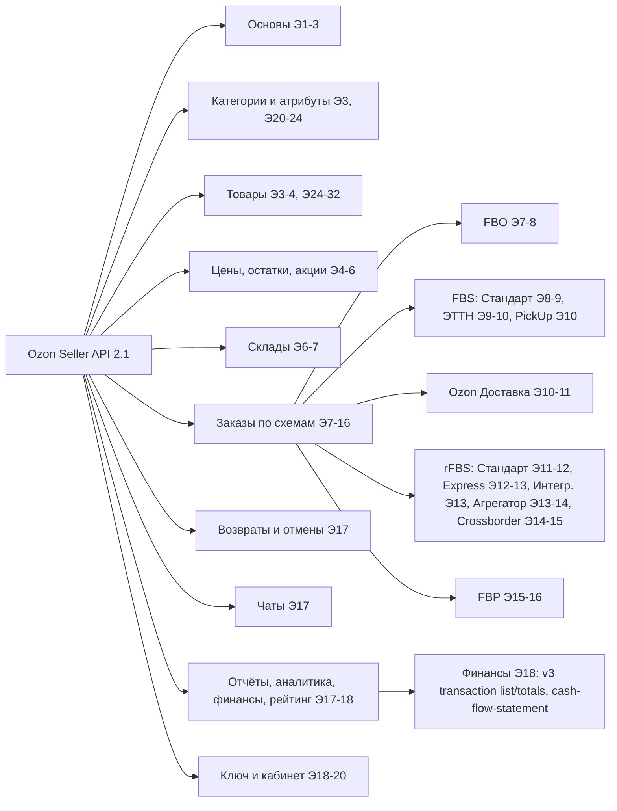

# Граф документации Ozon Seller API (2.1)

Источник: `FireShot Capture 001 - Документация Ozon Seller API - [docs.ozon.ru].pdf`.
Это одна длинная страница из 32 склеенных скриншотов **без текстового слоя**, поиск по PDF не работает.
Номер **[Э N]** означает номер экрана (скриншота) сверху вниз. Высота экрана в PDF — 354,5 pt, поэтому экран N начинается примерно на `(N-1)·354,5` pt.

## Что есть в PDF, а чего нет

| Часть | Экраны | Полнота |
|---|---|---|
| «Общее описание»: авторизация, лимиты, сценарии по каждой схеме со списками методов | 1–18 | полностью |
| Подробные описания методов (параметры, примеры) | 18–32 | **только первые 17 методов** (роли, кабинет, категории, товары до `/v1/product/rating-by-sku`) |
| Подробные описания методов финансов, заказов, складов, отчётов | — | **нет в PDF** |

⚠ **Финансы:** в PDF указан `/v3/finance/transaction/list` [Э 18], но с **6 июля 2026** Ozon его отключил: он возвращает `400 {"code":9,"message":"obsolete method cannot be used"}`. PDF — снимок более ранней версии документации, актуальную замену нужно смотреть на docs.ozon.ru.

---

## Карта верхнего уровня

---

## 1. Основы [Э 1–3]
- Хост: `https://api-seller.ozon.ru`, все методы `POST`, JSON. [Э 3]
- Заголовки: `Client-Id`, `Api-Key`, `Content-Type: application/json`. [Э 3]
- Либо OAuth: `Authorization: Bearer ACCESS_TOKEN` (частное или публичное приложение). [Э 2]
- Срок жизни ключа — **3 месяца**, дата окончания — `expires_at` в `/v1/roles`. [Э 2]
- Лимит: **50 запросов/сек на все методы с одного Client-Id**. За много одинаковых или ошибочных запросов доступ могут ограничить. [Э 3]
- Время в API — **UTC**. [Э 1]
- С 16.05.2025 разрешены только server-to-server запросы, из браузера будет ошибка CORS. [Э 1]
- Если оферта не принята: `403 Offer not signed`. [Э 1]
- Сертификат TLS меняется с GlobalSign на HARICA. [Э 1]

## 2. Ключ и кабинет [Э 18–20]
- `/v1/roles` — роли и методы, доступные ключу, плюс `expires_at`. [Э 18]
- `/v1/seller/info` — компания (ИНН, ОГРН, налоговая система, валюта), рейтинги, подписка. [Э 18–19]
- `/v1/seller/ozon-logistics/info` — подключена ли Ozon Доставка, доступные схемы FBO/FBS. [Э 19–20]

## 3. Категории и атрибуты [Э 3, 20–24]
Порядок: tree → attribute → values.
- `/v1/description-category/tree` — дерево категорий и типов; товар создаётся только в категории последнего уровня. [Э 20]
- `/v1/description-category/attribute` — характеристики по `description_category_id` и `type_id`. [Э 21–22]
- `/v1/description-category/attribute/values` — словарь значений, `limit` до 2000, пагинация через `last_value_id` и `has_next`. [Э 22–23]
- `/v1/description-category/attribute/values/search` — поиск по значению, `limit` до 100. [Э 23–24]

## 4. Товары [Э 3–4, 24–32]
**Создание и обновление**
- `/v3/product/import` — создать или обновить товар, до 100 шт. за запрос, возвращает `task_id`. Подробно: лимиты `Item-Retry-After`, изображения (до 50), видео (`complex_id=100001`), видеообложка, таблица размеров (`id=13164`). [Э 3, 24–27]
- `/v1/product/import/info` — статус по `task_id`. [Э 27]
- `/v1/product/import-by-sku` — копия чужой карточки по SKU, до 1000. [Э 27–28]
- `/v1/product/attributes/update` — изменить только характеристики. [Э 4, 28–29]
- `/v2/product/pictures/import` — изображения (актуальный метод). [Э 3, 29]
- `/v1/product/pictures/import` — **Deprecated, отключается 01.10.2026**. [Э 30]
- `/v2/product/pictures/info` — статус загрузки изображений. [Э 3]
- `/v4/product/info/limit` — лимиты на операции с товарами. [Э 25]

**Чтение**
- `/v3/product/list` — список товаров, фильтр `offer_id`, `product_id`, `sku`, `visibility`; пагинация `last_id`, `limit` до 1000. [Э 3, 31]
- `/v3/product/info/list` — подробно: штрихкод, цена, категория, комиссия, ошибки модерации. [Э 4]
- `/v4/product/info/attributes`, `/v1/product/info/description`, `/v1/product/info/discounted`. [Э 4]
- `/v1/product/rating-by-sku` — контент-рейтинг. [Э 32]
- `/v1/product/placement-zone/info` — зоны размещения по SKU, до 150 шт., 10 запросов/сек. [Э 24]

**Удаление и архив**
- `/v2/products/delete`, `/v1/product/archive`, `/v1/product/unarchive`. [Э 4]

**Сертификаты** [Э 4]
- Справочники: `/v1/product/certificate/types`, `/v2/product/certification/list`, `/v1/product/certificate/status/list`, `/v2/product/certificate/accordance-types/list`, `/v1/product/certificate/rejection_reasons/list`.
- Действия: `/v1/product/certificate/list`, `/v1/brand/company-certification/list`, `/v1/product/certificate/create`, `/bind`, `/products/list`, `/product_status/list`, `/products/unbind`, `/delete`.

## 5. Цены, остатки, акции, стратегии [Э 4–6]
**Остатки и цены** [Э 4–5]
- `/v2/products/stocks` — обновить остатки FBS и rFBS (указывается `warehouse_id`).
- `/v4/product/info/stocks` — остатки FBO, FBS, rFBS, FBP.
- `/v2/product/info/stocks-by-warehouse/fbs` — остатки по складам FBS.
- `/v1/product/import/prices` — цена, цена до скидки, цена Premium, минимальная цена.
- `/v5/product/info/prices` — цены, **комиссии** и скидки по товарам.
- Резерв для юрлиц: `is_legal=true` в `/v3/posting/fbs/get|list|unfulfilled/list`.

**Акции Ozon** [Э 5]
- `/v1/actions`, `/v1/actions/candidates`, `/v1/actions/products`, `/v1/actions/products/activate`, `/v1/actions/products/deactivate`.
- Заявки на скидку: `/v1/actions/discounts-task/list`, `/approve`, `/decline`.

**Акции продавца** [Э 5]
- Создание: `/v1/seller-actions/create/{discount|discount-with-condition|installment|multi-level-discount|voucher}`.
- Изменение: `/v1/seller-actions/update/{…те же}`.
- Прочее: `/v1/seller-actions/list`, `/products/candidates`, `/products/add`, `/products/list`, `/products/delete`, `/voucher/get`, `/change-activity`, `/archive`.

**Стратегии ценообразования** [Э 5–6]
- `/v1/pricing-strategy/competitors/list`, `/list`, `/create`, `/info`, `/update`, `/delete`, `/status`.
- Товары в стратегии: `/v1/pricing-strategy/products/add`, `/products/list`, `/products/delete`, `/strategy-ids-by-product-ids`.

## 6. Склады [Э 6–7]
- `/v2/warehouse/list`, `/v2/delivery-method/list`. [Э 6]
- **FBS-склад** [Э 6]:
  - Создание: `/v1/warehouse/fbs/create/drop-off/list` → `/v1/warehouse/fbs/return-mile/check` → `/v1/warehouse/fbs/create/return-point/list` → `/v1/warehouse/fbs/create` → `/v1/warehouse/operation/status`.
  - Изменение: `/v1/warehouse/fbs/update`, первая миля — `/v1/warehouse/fbs/first-mile/update` (плюс `/return-mile/info`, `/update/return-point/list`, `/update/drop-off/list`).
  - Архив: `/v1/warehouse/archive`, `/v1/warehouse/unarchive`.
- **rFBS Express** [Э 7]:
  - «Партнёры Ozon»: `/v1/warehouse/erfbs/aggregator/create`, `/aggregator/delivery-method/update`.
  - «Вы или сторонняя служба»: `/v1/warehouse/erfbs/non-integrated/create`, `/non-integrated/delivery-method/update`.
  - Общие: `/v1/warehouse/erfbs/update`, `/v1/delivery-method/return/settings/get`.
  - Полигоны: `/v1/polygon/create`, `/v2/polygon/bind`, `/v1/polygon/list`, `/delete`, `/time/coordinates/update`, `/time/set`.

## 7. Заказы по схемам [Э 7–16]

### FBO [Э 7–8]
- Отправления: `/v2/posting/fbo/list` (**также финансовые и аналитические данные по отправлению**), `/v2/posting/fbo/get`.
- Загрузка складов: `/v1/supplier/available_warehouses`.
- **Заявка на поставку:** `/v1/cluster/list` или `/v2/cluster/list` → черновик `/v1/draft/{direct|crossdock|multi-cluster}/create` (параметры: `/v1/warehouse/fbo/list`, `/v1/warehouse/fbo/seller/list`) → `/v2/draft/create/info` → `/v2/draft/timeslot/info` (до 28 дней) → `/v2/draft/supply/create` → `/v2/draft/supply/create/status`.
- **Заявки:** `/v3/supply-order/list`, `/v1/supply-order/status/counter`, `/v3/supply-order/get`, `/v1/supply-order/bundle`.
- **Таймслот и пропуск:** `/v1/supply-order/timeslot/get|update|status`, `/v1/supply-order/pass/create|status`.
- **Грузоместа:**
  - `/v1/cargoes/create`, `/v2/cargoes/get`, `/v2/cargoes/create/info`, `/v1/cargoes/rules/get`.
  - Этикетки: `/v1/cargoes-label/create|get`.
  - Удаление: `/v2/cargoes/delete` и `/delete/status`.
- **Транспортные грузоместа:**
  - `/v1/cargoes/transport/activate` (+`/status`), `/transport/create` (+`/status`), `/transport/bind` (+`/status`), `/v1/cargoes/supplies/get`.
  - Этикетки: `/v1/cargoes/label/transport-by-order/create|status`, `/v1/cargoes/label/transport/create|status`.

### FBS Стандарт [Э 8–9]
1. `/v3/posting/fbs/unfulfilled/list` или `/v3/posting/fbs/list` (с `with.analytics_data`). Страна производства: `/v2/posting/fbs/product/country/list|set`.
2. `/v3/posting/fbs/get`, `/v2/posting/fbs/get-by-barcode`.
3. Маркировка «Честный ЗНАК»: `/v5/fbs/posting/product/exemplar/validate`, `/v6/…/exemplar/create-or-get`, `/v6/…/exemplar/set`, `/v5/…/exemplar/status`.
4. `/v1/posting/fbs/restrictions`.
5. Сборка: `/v4/posting/fbs/ship`, частичная — `/v4/posting/fbs/ship/package`. Статус меняется на `awaiting_deliver`.
6. `/v2/posting/fbs/package-label`.
7. Отгрузка: `/v2/posting/fbs/act/create` или `/v1/carriage/create` → `/v1/carriage/approve`.
8. `/v1/carriage/get`. Пропуск: `/v1/carriage/pass/create|update|delete`, `/v1/pass/list`.
9. `/v1/posting/carriage-available/list` или `/v2/carriage/delivery/list`.
10. `/v2/posting/fbs/act/check-status` → `/act/get-barcode` → `/act/get-pdf`, `/v1/carriage/act-discrepancy/pdf`.
- Спор: `/v2/posting/fbs/arbitration`, `/v2/posting/fbs/awaiting-delivery`.
- Отмена: `/v2/posting/fbs/cancel-reason/list` → `/v2/posting/fbs/cancel`, частичная — `/v2/posting/fbs/product/cancel`.

### FBS с электронными ТТН [Э 9–10]
- Отправления: `/v3/posting/fbs/list` (фильтр `is_blr_traceable`), `/v1/posting/fbs/traceable/split`, `/v1/posting/fbs/product/traceable/attribute`, `/v4/posting/fbs/ship`.
- Перевозки: `/v2/carriage/delivery/list` → `/v1/carriage/create` (`is_blr_traceable=true`) → `/v1/carriage/get` → ЭДО → `/v1/carriage/ettn/status` → `/v1/carriage/approve`, `/v1/carriage/set-postings`.

### FBS PickUp с доверительной приёмкой [Э 10]
- Как FBS Стандарт, плюс в конце `/v2/posting/fbs/act/get-container-labels`.

### Ozon Доставка [Э 10–11]
- Доставка: `/v1/delivery/check`, `/v1/delivery/map`, `/v1/delivery/point/list`, `/v1/delivery/point/info`, `/v2/delivery/checkout`.
- Заказ: `/v2/order/create`, `/v1/posting/marks`. Отслеживание: `/v2/posting/fbo/list|get`, `/v3/posting/fbs/list|get|unfulfilled/list`.
- Отмена: `/v1/cancel-reason/list-by-order`, `/v1/cancel-reason/list-by-posting`, `/v1/order/cancel/check`, `/v1/order/cancel` (+`/status`), `/v1/posting/cancel` (+`/status`).
- Возвраты: `/v1/returns/list` (`PartialReturn`, `PartialRefund`). Остатки: `/v1/analytics/stocks`, `/v4/product/info/stocks`.

### rFBS Стандарт [Э 11–12]
- Шаги 1–4 как в FBS. Плюс `/v1/posting/cutoff/set`, весовые товары через `/v6/…/exemplar/set`.
- Дата доставки: `/v1/posting/fbs/timeslot/set`, `/v1/posting/fbs/timeslot/change-restrictions`.
- Статусы: `/v2/fbs/posting/delivering` → `/v2/fbs/posting/last-mile` → `/v2/fbs/posting/delivered`; трек-номер — `/v2/fbs/posting/tracking-number/set`.

### rFBS Express с доставкой в ПВЗ [Э 12–13]
- Как FBS до `/v2/posting/fbs/package-label`. Дальше статусы меняются автоматически: `on_way_to_city` → `on_way_to_pickup_point` → `in_pickup_point` → `delivered`.

### rFBS с интегрированной службой [Э 13]
- Как FBS до сборки. Статусы после «Доставляется» передаёт служба доставки.

### rFBS Агрегатор [Э 13–14]
- Плюс `/v3/posting/multiboxqty/set` (несколько коробок), статусы `awaiting_registration` → `awaiting_delivery`, декларации ETGB (Турция) — `/v1/posting/global/etgb`.

### rFBS Crossborder [Э 14] и Crossborder с интегрированной службой [Э 15]
- Crossborder — как rFBS Стандарт, с `cutoff/set` и статусами `delivering`, `last-mile`, `delivered`.
- Crossborder с интегрированной службой — как rFBS с интегрированной службой.

### Весовые товары rFBS [Э 15]
- `/v6/fbs/posting/product/exemplar/set` (вес), ошибки `WEIGHT_IS_OUT_OF_RANGE`, `WEIGHT_IS_REQUIRED`; признак `is_weight_needed` в `/v3/posting/fbs/get`.

### FBP (партнёрские склады) [Э 15–16]
- **Прямая поставка:**
  - `/v1/fbp/warehouse/list`, `/v1/fbp/draft/direct/product/validate`, `/v1/fbp/draft/direct/timeslot/get`, `/v1/fbp/draft/list|get`, `/v1/fbp/draft/direct/delete`, `/v1/supply-order/bundle`, `/v1/fbp/draft/direct/registrate`.
  - `/v1/fbp/order/direct/timeslot/list|edit`, `/v1/fbp/order/direct/seller-dlv/edit`, `/tpl-dlv/edit`, `/v1/fbp/order/list|get`, `/v1/fbp/order/direct/cancel`.
  - Документы: `/v1/fbp/label/create|get`, `/v1/fbp/act-to/create|get`, `/v1/fbp/act-from/create|get`, `/v1/fbp/archive/list|get`.
- **Drop-off на пункт партнёра:** `/v1/fbp/draft/drop-off/product/validate`, `/province/list`, `/point/list`, `/point/timetable`, `/create`, `/dlv/edit`, `/delete`, `/registrate`; `/v1/fbp/order/drop-off/timetable`, `/dlv/edit`, `/cancel`; документы те же.
- **Pick-up со склада продавца:** `/v1/fbp/draft/pick-up/product/validate`, `/create`, `/dlv/edit`, `/delete`, `/registrate`; `/v1/fbp/order/pick-up/dlv/edit`, `/cancel`; документы те же.

### Архив актов [Э 16]
- `/v2/posting/fbs/act/list`, `/v2/posting/fbs/act/get-postings`.

## 8. Возвраты и отмены [Э 17]
- `/v1/returns/list` — информация о возвратах.
- Возвратные отгрузки: `/v1/return/giveout/is-enabled`, `/get-pdf`, `/get-png`, `/barcode`, `/list`, `/info`; пропуск — `/v1/return/pass/create|update|delete`, `/v1/pass/list`.
- Возвраты rFBS: `/v2/returns/rfbs/list`, `/v2/returns/rfbs/get`, `/v1/returns/rfbs/action/set`.
- Заявки на отмену: `/v2/conditional-cancellation/list`, `/approve`, `/reject`.

## 9. Чаты [Э 17]
- `/v3/chat/list`, `/v1/chat/send/message`, `/v1/chat/send/file`, `/v3/chat/history`, `/v1/chat/start`, `/v2/chat/read`.

## 10. Отчёты, аналитика, финансы, рейтинг [Э 17–18]
**Отчёты (асинхронно):** `…/create` возвращает код отчёта → `/v1/report/info` (файл) → `/v1/report/list` (история). [Э 17]
- `/v1/report/products/create` — товары: Ozon ID, цены, комиссии, габариты.
- `/v3/finance/transaction/list` — «отчёт по транзакциям» ⚠ отключён 06.07.2026.
- `/v4/product/info/price` — цены.
- `/v1/report/warehouse/stock` — остатки на складе.
- `/v2/report/returns/create` — возвраты FBS и rFBS.
- `/v1/report/postings/create` — отправления.
- `/v1/finance/cash-flow-statement/list` — **финансовый отчёт** (движение денег по периодам). [Э 18]
- `/v1/report/discounted/create` — уценённые товары. [Э 18]

**Аналитика** [Э 18]
- `/v1/analytics/data` — метрики за период с группировкой `dimensions`.
- `/v1/analytics/stocks` — остатки на складах.
- Отчёт по оборачиваемости FBO — только в личном кабинете.

**Финансы** [Э 18]
- `/v3/finance/transaction/list` — транзакции по отправлениям. ⚠ **Отключён 06.07.2026** (`code 9, obsolete method`).
- `/v3/finance/transaction/totals` — итоговые суммы транзакций за период. Проверить, работает ли ещё.
- Смежные источники денег: `/v1/finance/cash-flow-statement/list`, `/v5/product/info/prices` (комиссии), `/v2/posting/fbo/list` (финансовые данные по отправлению), `/v1/report/postings/create`.

**Актуальные финансовые методы (в PDF их нет; формат восстановлен по открытой реализации ozon-mcp-server, issue #6)**
- `POST /v1/finance/accrual/by-day` — тело `{"date": "YYYY-MM-DD", "last_id": "…"}`, **ровно один день**. Ответ: `{"accruals": [...], "last_id": "..."}`; пагинация идёт, пока `last_id` не пустой.
  - Начисление: `total_amount {amount, currency}`, `accrued_category` (ITEM / POSTING / NON_ITEM), `accrual_id`.
  - `posting.products[].delivery.services[] {type_id, accrued{amount}}` и `item_fees.fees[].fees[] {type_id, accrued}`.
  - Часть чисел приходит строкой в protobuf-обёртке `value:"0.42"`.
- `POST /v1/finance/accrual/types` — тело `{}` → `accrual_types[] {id, name, description}`. Нужен для расшифровки `type_id` (1 — эквайринг, 32 — обратная логистика, 45 и 59 — возвраты).
- `POST /v1/finance/accrual/postings` — начисления по отправлениям (формат не проверен).
- `/v2/finance/realization` — отчёт о реализации `{month, year}`; `/v1/finance/mutual-settlement` `{date: "YYYY-MM"}`; `/v1/finance/products/buyout`.
- Используется в [ozon_finance.py](ozon_finance.py).

**Рейтинг** [Э 18]
- `/v1/rating/summary`, `/v1/rating/history` (штрафные баллы Premium).

---

## Быстрый поиск: задача → раздел
| Задача | Куда смотреть |
|---|---|
| Финансы, расходы, ОПиУ | §10 Финансы [Э 18] + актуальная документация (v3 отключён) |
| Комиссии по товарам | `/v5/product/info/prices` [Э 5], `/v1/report/products/create` [Э 17] |
| Выручка и отправления | `/v2/posting/fbo/list` [Э 7], `/v3/posting/fbs/list` [Э 8], `/v1/report/postings/create` [Э 17] |
| Остатки | `/v4/product/info/stocks` [Э 5], `/v1/analytics/stocks` [Э 18] |
| Проверить права ключа | `/v1/roles` [Э 18] |
| Данные юрлица | `/v1/seller/info` [Э 19] |
| Лимиты | 50 запросов/сек на Client-Id [Э 3]; товары — `/v4/product/info/limit` [Э 25] |
